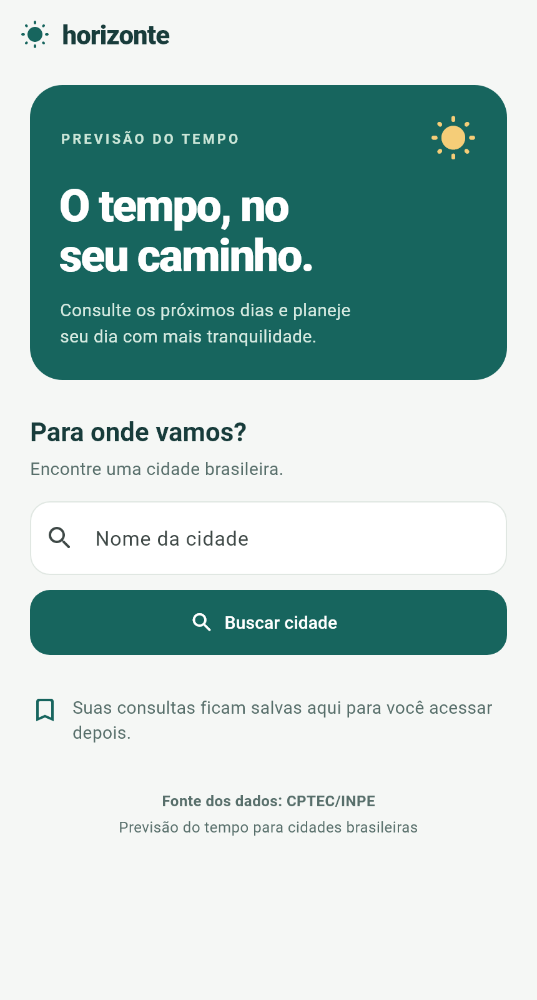
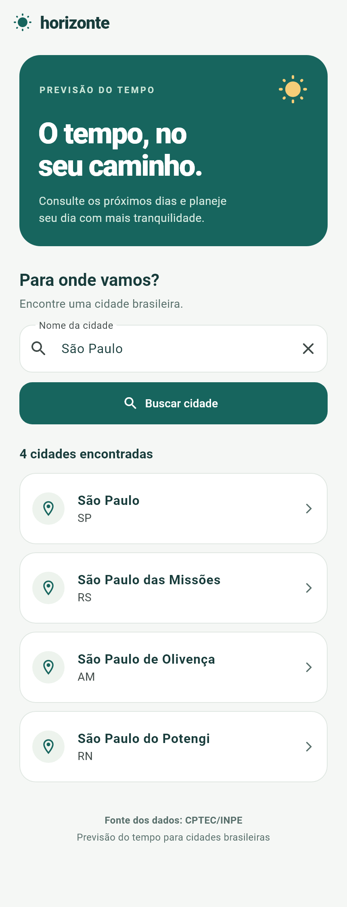
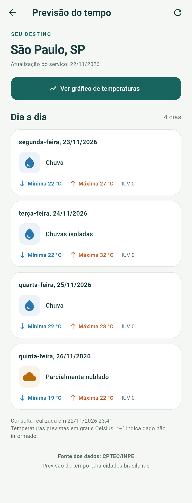
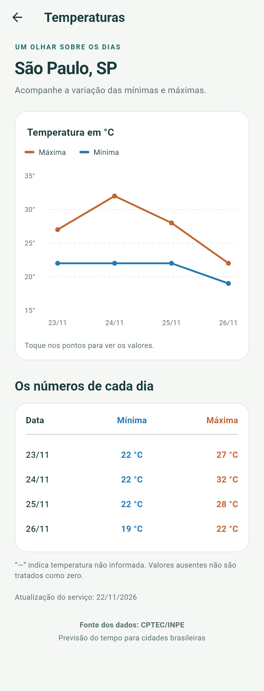
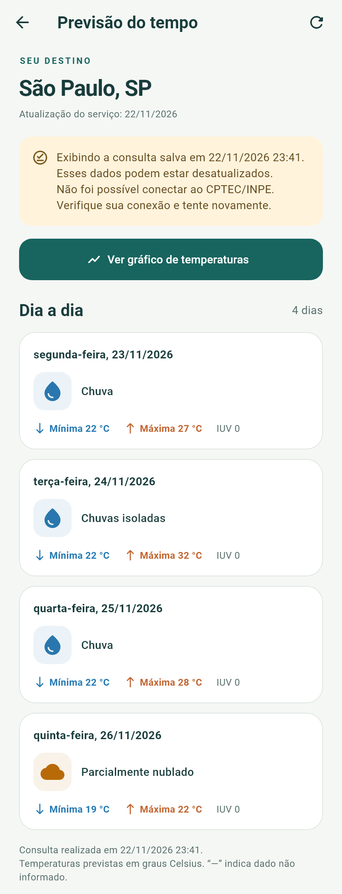

# Horizonte | Previsão do tempo

Aplicativo Flutter desenvolvido para a **Atividade 2 de Programação para Dispositivos Móveis II**. Consulta cidades brasileiras e a previsão de quatro dias diretamente no serviço XML do **CPTEC/INPE**, com histórico local e gráfico de temperaturas.

## Funcionalidades

- Busca pelo nome da cidade, com normalização de acentos e espaços.
- Resultados com nome e UF; a previsão usa o identificador retornado pelo CPTEC.
- Exibição de **todos os dias retornados** pelo endpoint de quatro dias.
- Data, mínima, máxima, descrição, ícone da condição do tempo e índice ultravioleta por dia.
- Data de atualização do serviço e horário da consulta exibidos separadamente.
- Conversão das 40 siglas oficiais em descrições em português, com alternativa para siglas desconhecidas.
- Atualização pelo botão no topo ou pelo gesto de puxar a tela para baixo.
- Navegação entre busca, previsão e gráfico com `Navigator` e `MaterialPageRoute`.
- Gráfico interativo das mínimas e máximas, legenda, valores ao toque e tabela para leitura acessível.
- Até oito consultas recentes salvas, disponíveis após fechar e reabrir o app.
- Indicadores de carregamento e mensagens para busca vazia, nenhum resultado, falha de conexão, timeout, serviço indisponível, XML inválido e ausência de previsão.
- Campos ausentes recebem indicação de indisponibilidade; temperaturas ausentes não viram zero no gráfico. IUV igual a zero é preservado.
- Layout adaptável, textos em português e identificação do CPTEC/INPE como fonte.

## Capturas de tela

As imagens são capturas da interface Flutter renderizada nos testes de widgets. As telas de dados usam respostas XML reais coletadas do CPTEC/INPE em **22/11/2026**, disponíveis em `test/fixtures/`. A tela offline simula uma falha de conexão depois de salvar a consulta. O aplicativo normal sempre consulta o serviço real; não possui modo de demonstração nem dados fixos em produção.

| Início | Busca de cidades | Previsão |
| --- | --- | --- |
|  |  |  |

| Gráfico de temperaturas | Consulta salva sem conexão |
| --- | --- |
|  |  |

## Executar o projeto

Ambiente de referência: **Flutter 3.41.9**, **Dart 3.11.5**, Android SDK 36 e JDK 21. As versões resolvidas das dependências estão no `pubspec.lock`, que deve ser mantido no repositório.

1. Instale o Flutter e o Android SDK, ou utilize o Android Studio com o SDK configurado.
2. Abra um emulador Android ou conecte um aparelho com depuração USB habilitada.
3. No terminal, entre na pasta do projeto e execute:

```sh
flutter doctor
flutter pub get
flutter devices
flutter run -d ID_DO_DISPOSITIVO
```

Substitua `ID_DO_DISPOSITIVO` pelo identificador Android listado em `flutter devices`. Também é possível abrir a pasta no VS Code ou Android Studio, selecionar um dispositivo e executar `lib/main.dart`.

Não é necessário cadastro, chave de API, arquivo `.env` ou servidor próprio. A primeira consulta de uma cidade exige conexão com a internet.

### Gerar o APK

```sh
flutter build apk --debug
```

Arquivo gerado: `build/app/outputs/flutter-apk/app-debug.apk`. Esse APK usa assinatura de desenvolvimento, adequada para instalação e avaliação local. A pasta `build/` não é versionada.

O alvo principal de validação é Android. O projeto também contém a estrutura iOS, cuja compilação requer macOS e Xcode, e a estrutura web. No navegador, a consulta direta depende da política CORS do CPTEC; utilize Android para avaliar a integração sem as restrições do navegador.

## Bibliotecas utilizadas

| Biblioteca | Finalidade |
| --- | --- |
| Flutter / Material 3 | Interface, ícones, estados e navegação |
| `flutter_localizations` | Componentes do Flutter em português brasileiro |
| [`http`](https://pub.dev/packages/http) | Requisições HTTPS com limite de espera de 15 segundos |
| [`xml`](https://pub.dev/packages/xml) | Leitura e validação da estrutura XML |
| [`shared_preferences`](https://pub.dev/packages/shared_preferences) | Armazenamento local das consultas |
| [`fl_chart`](https://pub.dev/packages/fl_chart) | Gráfico de linhas e interação com os pontos |
| [`intl`](https://pub.dev/packages/intl) | Formatação de datas e números em português |
| `flutter_test` / `flutter_lints` | Testes automatizados e análise estática |

## Persistência local

O `LocalStore` serializa as consultas em JSON na chave `horizonte.forecasts.v1` do `SharedPreferences`. Cada registro contém o ID, nome e UF da cidade, todos os dias da previsão, a data de atualização do serviço e o horário em que os dados foram obtidos.

O repositório mantém no máximo **oito cidades**, em ordem da consulta mais recente. Uma nova consulta bem-sucedida substitui a anterior da mesma cidade. Uma resposta válida sem dias também substitui a previsão antiga, para não apresentar dados anteriores como uma atualização bem-sucedida.

Ao abrir uma cidade já consultada, o app mostra os dados locais e tenta atualizá-los. Se a conexão falhar, mantém o cache **daquela mesma cidade**, informa a falha e identifica a consulta como salva e possivelmente desatualizada. O cache não expira automaticamente, permitindo leitura offline; as datas continuam visíveis e há um aviso adicional quando todos os dias da previsão já passaram.

As consultas são recuperadas na inicialização. Cache corrompido não impede a busca de novos dados. Se a gravação falhar, a previsão recebida continua visível e o app avisa que não conseguiu persistir a consulta. Desinstalar o aplicativo ou limpar seus dados remove o histórico local.

## Serviço e organização

Documentação oficial: [Serviços XML do CPTEC/INPE](https://servicos.cptec.inpe.br/XML/).

```text
Busca:    https://servicos.cptec.inpe.br/XML/listaCidades?city=nome_da_cidade
Previsão: https://servicos.cptec.inpe.br/XML/cidade/{id}/previsao.xml
```

A busca envia o parâmetro `city` sem acentos. O código de previsão vem do campo `id` da cidade selecionada. A decodificação respeita a declaração XML, incluindo **ISO-8859-1**, utilizada pelo serviço, e UTF-8. Não há troca por outra API meteorológica.

```text
lib/
  main.dart                       Inicialização e carregamento do histórico
  app.dart                        Tema e localização
  models/                         Cidade, previsão e condições do tempo
  services/cptec_client.dart       HTTPS, codificação, XML e erros
  services/local_store.dart       Leitura e gravação do JSON local
  services/weather_repository.dart Integração entre serviço e cache
  screens/                        Busca, previsão e gráfico
  widgets/common.dart             Componentes e formatação reutilizáveis
test/                             Testes e respostas XML de referência
docs/screenshots/                 Capturas das funcionalidades
tool/check_service.dart           Verificação opcional do serviço real
assets/branding/                  Fonte vetorial do ícone do aplicativo
```

## Validação

```sh
flutter analyze
flutter test
dart run tool/check_service.dart
```

Os testes não dependem da disponibilidade do CPTEC: verificam requisições, codificação, XML, campos ausentes, erros, cache após recriar o repositório, navegação, atualização, gráfico e layout estreito. O último comando faz uma consulta real pela mesma implementação usada no app.

Para regenerar as capturas:

```sh
flutter test test/app_test.dart --dart-define=CAPTURE_SCREENSHOTS=true
```

O fluxo de GitHub Actions em `.github/workflows/flutter.yml` executa formatação, análise e testes a cada push ou pull request. No Windows, a compilação incremental do Kotlin está desativada para evitar o erro de cache quando o projeto e as dependências ficam em unidades diferentes, como `D:` e `C:`.

## Entrega

Repositório: [IgorSantosL/Atividade_2_Dispositivos_moveis_2](https://github.com/IgorSantosL/Atividade_2_Dispositivos_moveis_2).

Após revisar os arquivos, publique as alterações:

```sh
git add .
git commit -m "Implementa aplicativo de previsao do tempo com CPTEC"
git push origin main
```

Envie o link do repositório na tarefa correspondente do Teams.
